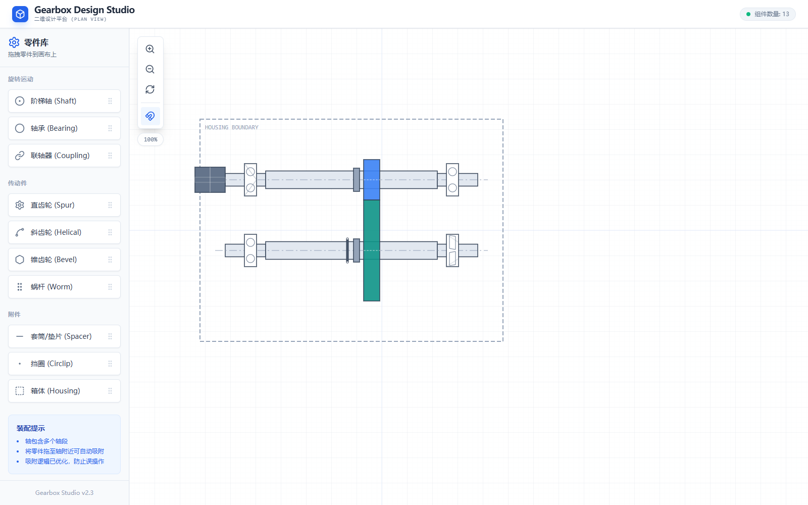
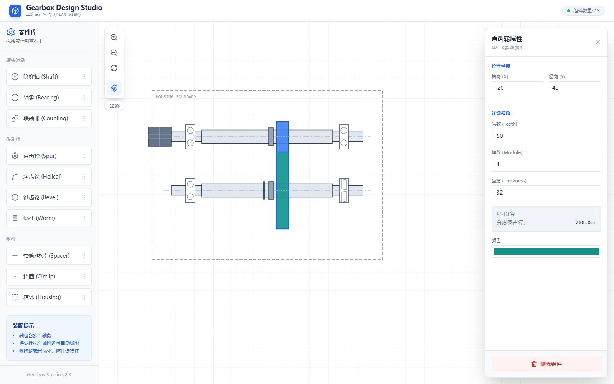
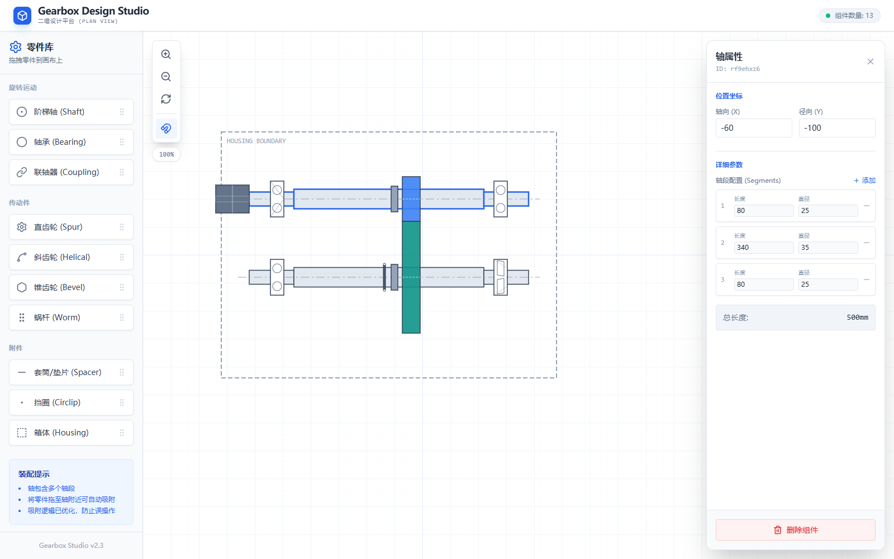
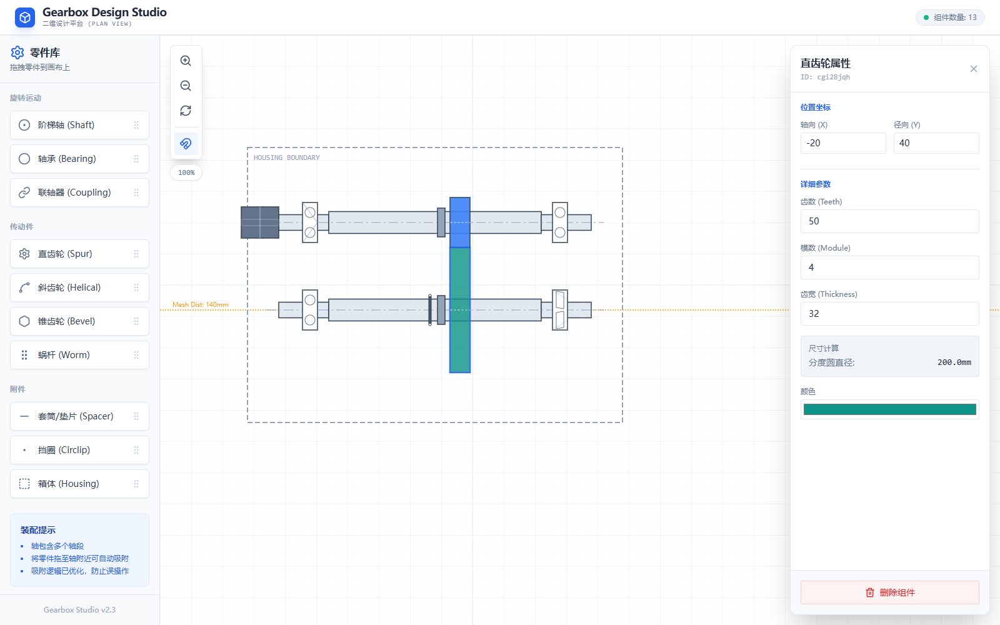

# Gearbox Design Studio 2D

**中文** · [English](README.en.md)

[](https://react.dev/) [](https://www.typescriptlang.org/) [](https://vite.dev/) [](LICENSE)

在浏览器中拖拽机械零件、调整几何参数，搭建减速箱的二维装配布局。

Gearbox Design Studio 2D 是基于 React、TypeScript 和 SVG 的交互式布局工具，适合方案讨论、教学演示和初步布置。工作区采用沿轴向展开的简化平面示意：轴沿 X 方向布置，齿轮以齿宽和分度圆直径对应的矩形显示。



*图 1 · 真实运行界面。示例包含箱体边界、两根阶梯轴、四个轴承、两个直齿轮、两个套筒、一个联轴器和一个挡圈，共 13 个组件。此布局用于演示操作，未经过工程校核。*

## 目录

- [快速开始](#快速开始)
- [功能与组件](#功能与组件)
- [界面与基本操作](#界面与基本操作)
- [搭建一个双轴示例](#搭建一个双轴示例)
- [参数、单位与吸附规则](#参数单位与吸附规则)
- [当前范围与限制](#当前范围与限制)
- [开发说明](#开发说明)
- [常见问题](#常见问题)

## 快速开始

### 环境准备

- Node.js 和 npm。本说明在 **Node.js 24.19.0** 环境中验证。
- 支持 SVG、鼠标指针事件和 HTML 拖放的桌面浏览器；截图使用 Chrome。
- 安装依赖时需要访问 npm registry；界面样式运行时依赖 `https://cdn.tailwindcss.com`，因此当前版本需要联网加载样式。

### 安装与启动

```bash
git clone https://github.com/Lilililiyyy/Gearbox-Design-Studio-2D.git
cd Gearbox-Design-Studio-2D
npm install
npm run dev
```

打开终端输出的地址。配置端口为 `3000`，通常是 `http://localhost:3000`；端口被占用时，Vite 会尝试后续端口，以终端输出为准。

当前二维布局功能**不需要 API Key，也不需要后端服务**。

### 构建与本地预览

```bash
npm run typecheck
npm run build
npm run preview
```

`tsc` 检查类型，构建产物写入 `dist/`。`preview` 用于本地检查构建结果，访问地址以终端输出为准。运行页面仍然需要加载 Tailwind CSS CDN。

## 功能与组件

从左侧零件库拖拽组件到画布，再通过右侧浮动属性面板修改参数。

| 组件 | 属性面板可编辑内容 | 图形表现 |
| --- | --- | --- |
| 阶梯轴 / Shaft | 各轴段的长度、直径；添加或移除轴段 | 多段轴轮廓和中心线，显示总长度 |
| 轴承 / Bearing | 类型、宽度、外径 | 六种不同的轴承示意符号 |
| 直齿轮 / Spur | 齿数、模数、齿宽、颜色 | 按分度圆直径绘制的矩形示意 |
| 斜齿轮 / Helical | 齿数、模数、齿宽、螺旋角、颜色 | 矩形轮廓及固定斜线标识 |
| 锥齿轮 / Bevel | 齿数、模数、齿宽、颜色、四档装配方向 | 简化锥形轮廓标识 |
| 蜗杆 / Worm | 长度、直径 | 圆角矩形及螺纹示意线 |
| 联轴器 / Coupling | 宽度 / 长度、外径 | 带中间分界线的轮廓 |
| 套筒 / 垫片 / Spacer | 宽度 / 长度、外径 | 矩形轮廓 |
| 挡圈 / Circlip | 宽度 / 长度、外径 | 窄条及两端孔位标识；图形宽度固定 |
| 箱体 / Housing | 宽度、高度 | 虚线边界框 |

所有组件都能编辑 X、Y 坐标。轴承类型包括深沟球轴承、角接触球轴承、圆柱滚子轴承、圆锥滚子轴承、调心轴承和推力轴承；它们是类型示意，不是标准型号选型数据库。

## 界面与基本操作

| 区域 / 操作 | 用法 |
| --- | --- |
| 左侧零件库 | 按“旋转运动”“传动件”“附件”分组；拖动卡片添加组件 |
| 中间画布 | 查看网格、中心线和装配布局 |
| 顶部数量提示 | 显示当前组件总数 |
| 属性面板 | 点击组件打开；输入参数立即更新图形；右上角 × 关闭面板 |
| 移动组件 | 按住组件拖动；选中后轮廓变为蓝色 |
| 平移视图 | 在空白画布上拖动，或滚动鼠标滚轮；也支持按住 Shift 在空白处拖动 |
| 缩放 | 使用“放大 / 缩小”按钮，或 Ctrl / ⌘ + 滚轮 |
| 重置视图 | 点击“重置视图”，恢复初始视口及 100% 缩放；组件仍保留 |
| 自动吸附 | 点击磁铁按钮切换拖动时的自动吸附，默认开启 |
| 删除组件 | 选中组件后，点击属性面板底部“删除组件” |

当前界面以中文为主，零件卡片带有英文名称。中英文说明文件并不代表软件已提供语言切换功能。



*图 2 · 选中大齿轮后，可看到齿数 50、模数 4、齿宽 32，以及自动显示的分度圆直径 200.0 mm。*

## 搭建一个双轴示例

以下参数可复现截图中的主要布局。先拖入组件，再在属性面板输入精确坐标和尺寸；不需要依靠鼠标落点达到指定位置。

1. 添加箱体，设置中心 `X = -60`、`Y = 0`，宽 `600`、高 `440`。
2. 添加两根阶梯轴，中心分别为 `(-60, -100)` 和 `(-60, 40)`。两根轴都设置为三段，参数见下表，总长度均为 `500 mm`。
3. 在两根轴上各放置两个轴承：X 坐标为 `-260` 和 `140`，Y 坐标与对应轴一致；轴承宽 `24`、外径 `64`。
4. 添加两个直齿轮，参数见下表。两者 X 坐标相同，Y 坐标分别与两根轴一致。
5. 在 `(-50, -100)` 和 `(-50, 40)` 添加套筒，宽 `12`、外径 `46`；在 `(-340, -100)` 添加联轴器，宽 `60`、外径 `50`；在 `(-68, 40)` 添加挡圈，外径 `42`。
6. 可将上方左侧轴承改为角接触球轴承、下方右侧轴承改为圆锥滚子轴承，并将大齿轮颜色改为 `#0d9488`，与示例图一致。

| 轴段（两根轴相同） | 长度 / mm | 直径 / mm |
| --- | ---: | ---: |
| 1 | 80 | 25 |
| 2 | 340 | 35 |
| 3 | 80 | 25 |

| 齿轮 | 中心坐标 (X, Y) | 齿数 z | 模数 m | 齿宽 / mm | 分度圆直径 / mm |
| --- | --- | ---: | ---: | ---: | ---: |
| 小齿轮 | (-20, -100) | 20 | 4 | 32 | 80 |
| 大齿轮 | (-20, 40) | 50 | 4 | 32 | 200 |

程序显示的分度圆直径按 `d = z × m` 计算；本例两齿轮的简化吸附间距为 `(80 + 200) / 2 = 140 mm`，与两个 Y 坐标之差一致。



*图 3 · 每个轴段独立设置长度和直径。“添加”插入新轴段，行末减号移除轴段；至少保留一个轴段。*

要观察吸附提示，可开启磁铁开关，抓住大齿轮远离轴中心线的部分，轻微上下拖动。当接近 `140 mm` 的间距时，会出现橙色 `Mesh Dist: 140mm` 辅助线。截图中的两个齿轮在分度圆示意边界处相接，图中没有绘制实际齿形。



*图 4 · 拖动过程中的间距吸附。此提示只反映程序的简化几何规则，不代表已经完成啮合或干涉校核。*

## 参数、单位与吸附规则

### 坐标和尺寸

- X 表示轴向位置，向右为正；Y 表示画布横向布轴的位置，向下为正。负坐标可以正常使用。
- 参数中的长度按毫米理解，角度按度理解。缩放只改变视图，不改变尺寸参数；屏幕显示比例不是可校准的打印比例。
- 新建组件的初始落点始终对齐 `10` 单位网格，即使磁铁开关关闭也是如此。
- 直接输入 X、Y 坐标绕过拖动吸附；直接修改轴坐标也不会触发轴上零件的联动。

### 拖动吸附

| 被拖动对象 | 自动吸附开启时的规则 |
| --- | --- |
| 轴 | X、Y 对齐 `10` 单位网格 |
| 箱体 | X、Y 对齐 `20` 单位网格 |
| 其他组件 | X 对齐 `10` 单位网格；Y 优先采用齿轮间距吸附，其次采用轴线吸附，最后采用网格吸附 |

轴线吸附只比较 Y 距离，接近时显示绿色辅助线；当前算法不检查该零件是否落在轴的实际长度范围内。齿轮间距吸附适用于直齿轮、斜齿轮和锥齿轮，使用两个 `z × m / 2` 的半径之和确定 Y 间距，不检查 X 对齐、模数匹配或齿轮类型是否相容。默认比例下，轴线和齿轮间距的接近阈值分别约为 25 和 20 个屏幕像素。

### 轴与零件联动

拖动轴时，程序同时移动满足以下条件的零件：与轴原来的 Y 坐标相差小于 `0.1`，并且零件中心位于轴原有长度范围向两端各扩展 `20` 单位的区域内。其他轴和箱体不参与联动。

这是一种根据位置推断的联动，没有建立永久的装配绑定关系。修改轴段长度或直接输入轴坐标后，需要自行检查零件的位置。

## 当前范围与限制

以下内容用于明确当前实现，避免把示意布局当作完整机械设计结果。

- **数据保留：**组件仅存储在当前页面的 React 状态中；刷新或关闭页面会丢失布局。没有项目保存 / 读取、自动保存、撤销或重做功能。
- **文件输出：**没有内置 PNG、SVG、DXF、STEP、PDF 或 BOM 导出入口。本文图片通过浏览器截图获取；需要记录当前布局时可使用浏览器或系统截图。
- **工程计算：**没有强度、寿命、效率、承载能力、运动仿真、碰撞检测或标准符合性校核。箱体仅为边界示意。
- **齿轮几何：**画布使用矩形和标识线，不绘制渐开线齿廓。直齿、斜齿和锥齿的显示直径都使用 `z × m`；没有法向 / 端面模数换算或锥齿轮节锥计算。螺旋角可编辑，但不会改变当前固定斜线的方向或间距。
- **参数覆盖：**数据类型中的压力角、孔径 / 内径等字段没有完整对应的编辑控件，也未参与当前装配校核。只有锥齿轮提供 `0° / 90° / 180° / 270°` 方向按钮；轴仍沿 X 方向显示。
- **输入校验：**部分数字输入具有 HTML 最小 / 最大值提示，但没有统一的参数合法性和尺寸相容性校验；请使用合理的正尺寸和整数齿数。挡圈的宽度字段不会改变当前固定的图形宽度。
- **版本：**侧栏显示 `v2.3`，`package.json` 的包版本为 `0.0.0`。

## 开发说明

本项目采用 [MIT License](LICENSE)。如需闭源集成，可[联系作者](https://github.com/Lilililiyyy)获取商业授权。

### 技术栈

| 部分 | 实现 |
| --- | --- |
| 界面 | React 19.2、TypeScript 5.8 |
| 开发与构建 | Vite 6、`@vitejs/plugin-react` |
| 绘图 | SVG，包含网格、图形和辅助线 |
| 样式 | Tailwind CSS CDN |
| 图标 | Lucide React |
| 状态 | React `useState`，不含后端或数据库 |

版本系列来自 `package.json`；当前没有提交依赖锁文件，实际安装的补丁 / 次版本可能变化。

### 代码结构

```text
.
├── index.html                  # HTML 容器、CDN 样式和应用入口
├── index.tsx                   # React 挂载
├── App.tsx                     # 组件状态、默认参数、轴与零件联动
├── types.ts                    # 组件类型、参数结构、网格常量
├── components/
│   ├── ComponentPalette.tsx    # 零件库和拖拽来源
│   ├── DesignCanvas.tsx        # SVG 渲染、平移缩放、拖动及吸附
│   └── PropertiesPanel.tsx     # 属性编辑与删除
├── utils/geometry.ts           # 几何辅助函数；当前画布未引用
├── docs/images/                # 本说明使用的真实运行截图
├── README.md                   # 中文说明
└── README.en.md                # 英文说明
```

新增组件时，需要同步考虑 `types.ts`、`App.tsx` 的默认参数、零件库、画布渲染和属性面板，并明确其吸附行为。

## 常见问题

| 现象 | 处理方式 |
| --- | --- |
| 安装时提示 Node.js 版本不满足依赖要求 | 使用满足依赖 `engines` 的 Node.js；本文运行验证使用 24.19.0 |
| 页面没有样式，零件库和画布布局错乱 | 检查浏览器是否能加载 `https://cdn.tailwindcss.com` |
| 启动地址不是 3000 端口 | 端口可能被占用，打开 Vite 终端实际打印的地址 |
| 刷新后组件消失 | 当前没有持久化；刷新前先截图记录 |
| 拖入零件后没有吸附到轴上 | 新建只按网格定位；再拖动已创建的零件靠近轴线，并确认磁铁开关开启 |
| 想精确移动组件 | 在属性面板输入 X、Y；此方式不触发自动吸附或轴上零件联动 |
| 齿轮接近时吸附到意外位置 | 可能触发了优先级更高的间距吸附；暂时关闭磁铁，再输入坐标 |
| 组件移动到视野外 | 平移或缩小查找；“重置视图”只恢复初始视口，不自动适配所有组件 |
